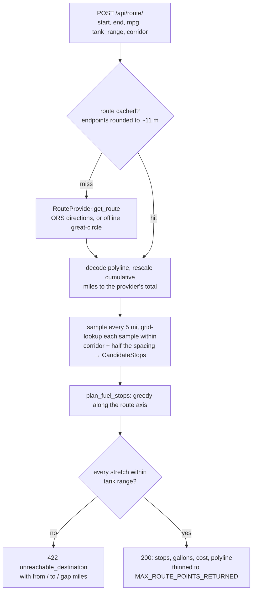
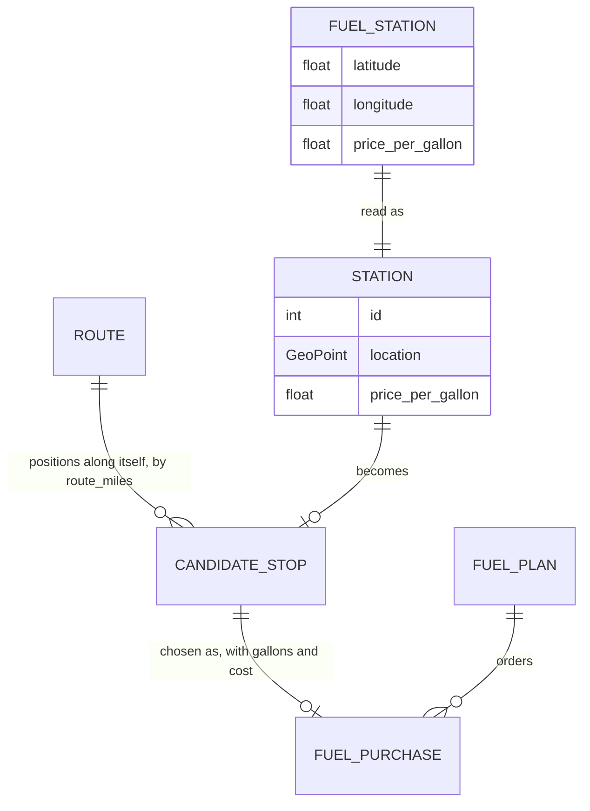

# Fuel-Optimised Route Planner

Given two coordinates, a vehicle's MPG and its tank range, this Django REST API returns the driving
route between them and the **cheapest possible sequence of fuel stops** along it: which stations to
use, how many gallons to buy at each, what the trip costs. Prices come from a CSV catalogue; routes
come from OpenRouteService, or from a bundled offline provider so the project runs and demos with no
API key.

One endpoint matters, `POST /api/route/`, and the interesting part is not its plumbing: the stop
plan is provably the cheapest one, not a good heuristic, with an oracle in the tests to prove it.

## Buying fuel on a line

Projecting each station onto the route collapses the geography, and what is left is the classic
**gas station problem**: drive from mile 0 to mile *D*; the tank holds *R* miles of fuel and starts
full; fuel at mile `p_i` costs `c_i` per gallon and may be bought in any quantity. Minimise the
spend. Because fuel is divisible a greedy rule is optimal here — no dynamic programme required.
Standing at station *i* holding `f` miles of range, with *W* the stations within *R*:

1. **If some station in *W* costs no more than `c_i`**, take the *first* such station *j* and buy
   exactly enough to reach it, `max(0, (p_j - p_i) - f)`. Buying more would carry expensive fuel
   past an equally cheap pump.
2. **Otherwise `c_i` is the cheapest price in the entire window**, so fill the tank and drive to the
   cheapest station in *W* — the farthest one on a tie, which costs nothing and yields fewer stops.

Two sentinels delete every special case. The destination is a station at mile *D* priced at **$0**,
so rule 1 covers the final leg and buys exactly enough fuel to arrive rather than a tank that will
not be burned. The origin is a station priced at **infinity**, which encodes "no pump here" and
makes the free starting tank fall out of the same rule.

**Why it is optimal.** Total fuel burned is `D / mpg` whatever the plan, so minimising cost means
buying every gallon at the lowest price that can physically deliver it to where it is burned. Rule 1
never carries a gallon past a cheaper pump; rule 2 fills up only when no cheaper pump is reachable,
and an exchange argument converts any optimal plan into this one without increasing its cost.

**Cost.** `next_no_more_expensive` is one monotonic-stack pass, O(n); a sparse table answers
"cheapest station in `[l, r]`" in O(1) after an O(n log n) build; the window edge is a binary search
and every step moves strictly forward — **O(n log n)** for *n* candidate stops. Rescanning the
window at each station instead is O(n·|W|), quadratic in exactly the cross-country case this is
built for. All of it is [`api/optimizer/fuel.py`](api/optimizer/fuel.py) — 282 lines, a third of
them that argument written out in the docstring.

## Not taking the optimiser's word for it

[`api/tests/test_optimizer.py`](api/tests/test_optimizer.py) carries a deliberately naive
**exhaustive dynamic programme** over `(station, integer fuel level)` — `brute_force_cost` — and
`OptimalityTests.test_greedy_matches_brute_force_on_random_instances` runs the greedy against it on
**150 seeded random instances**, requiring the costs to agree to six decimal places *and* the two to
agree on whether the trip is feasible at all. The awkward cases are pinned individually rather than
left to the random sweep:

| Case | Behaviour | Test |
| --- | --- | --- |
| Route shorter than one tank, or exactly one tank | No stops, `$0` — the starting tank is free | `test_route_shorter_than_one_tank_needs_no_stops` |
| Gap between stations wider than the tank | `UnreachableDestination` naming the exact gap → 422 | `test_gap_between_stations_wider_than_the_tank` |
| Final leg longer than the tank | Same check; the destination is just another node | `test_final_leg_longer_than_the_tank` |
| No stations anywhere on a long route | `NoFuelStationsAvailable` → 422 | `test_no_stations_at_all_on_a_long_route` |
| Several equally cheap stations | Deterministic: the farthest, so no redundant stop | `test_equal_prices_resolve_to_the_farthest_station` |
| A station exactly at the range limit | Reachable (inclusive, epsilon-tolerant) | `test_exactly_at_range_is_reachable` |

`python manage.py test` runs 120 tests in well under a second. None touch the network — the ORS
client is driven by a fake `requests` session from `api/tests/doubles.py` — and the suite passes with
no `ORS_API_KEY` set, one asserting a missing key yields 503 rather than a traceback. Coverage of
application code is 99% (667 statements, 7 missed), captured with the `ruff` run in
[`docs/test-run.txt`](docs/test-run.txt).

## From two coordinates to a fuel plan

Nothing is geocoded; the request carries coordinates. The work is getting a polyline, deciding which
stations count as "on the route", then handing the 1-D problem over.



`FuelRoutePlanner` in `api/services.py` is the only place those pieces meet; `RouteAPIView.post`
validates, delegates, serialises, and contains no `try`/`except` at all. Domain errors are plain
exceptions with no DRF import, and one table in `api/exception_handlers.py` maps them onto 503 / 504
/ 502 / 404 / 422.

## What comes back

The full transcript, error cases included, is in [`docs/api-examples.md`](docs/api-examples.md).
Los Angeles to New York on 10 MPG and an 800-mile tank, cut to the first of its three stops:

```console
$ curl -s -X POST http://localhost:8370/api/route/ -H "Content-Type: application/json" \
    -d '{"start_lat": 34.05233, "start_lng": -118.24356, "end_lat": 40.71278,
         "end_lng": -74.006, "vehicle_mpg": 10, "tank_range_miles": 800, "corridor_miles": 200}'
{
    "provider": "static", "total_distance_miles": 2934.66, "total_fuel_cost": 872.73,
    "total_gallons": 213.47, "fuel_stop_count": 3, "candidate_station_count": 19,
    "fuel_stops": [
        {"station_name": "Sam's Club", "city": "Albuquerque", "state": "NM",
         "latitude": 35.0844, "longitude": -106.6504, "price_per_gallon": 4.02,
         "route_miles": 786.93, "detour_miles": 48.61, "gallons": 78.69, "cost": 316.35}
    ],
    "route": [[34.05233, -118.24356], "... 4 more ...", [40.71278, -74.006]],
    "route_points_returned": 6, "route_points_total": 201
}
```

Two stops and the request echo are elided, and `MAX_ROUTE_POINTS_RETURNED=6` kept the polyline on
the page (default 2000). `"provider": "static"` says out loud that these are great-circle
approximations, not road distances. When the tank cannot bridge a stretch, it says where:

```console
{"error": "No fuel stop is reachable between mile 786.9 and mile 1381.1: the 594.2 mile gap exceeds the 500.0 mile tank range.",
 "code": "unreachable_destination",
 "detail": {"from_miles": 786.93, "to_miles": 1381.14, "gap_miles": 594.21, "tank_range_miles": 500.0}}
```

There is no front end; the only visual surface is DRF's own browsable API, showing
[the plan](docs/screenshots/browsable-api-route-plan.png) and
[the 422](docs/screenshots/browsable-api-unreachable.png).

## Running it

```bash
python -m venv .venv && source .venv/bin/activate
pip install -r requirements.txt
python manage.py migrate                 # SQLite by default, no server needed
python manage.py load_fuel_data          # seeds fuel_prices_sample.csv
ROUTE_PROVIDER=api.routing.static.StaticRouteProvider python manage.py runserver 8370
```

A working API with no key and no database server. For real road routing set `ORS_API_KEY` and leave
`ROUTE_PROVIDER` at its default; without a key the provider returns 503 rather than failing obscurely.
**No key is committed anywhere** — every `ORS_API_KEY` in the tree and in the history is empty or a
placeholder, and the tests never need one.

`docker compose up --build` is authored to do the same end to end (Postgres 17, migrate, seed,
gunicorn, API on `localhost:8370`, offline provider by default), but **the image has not been built or
booted** — only `docker compose config -q` was run, so treat that path as unverified.
`requirements-dev.txt` adds pytest, pytest-cov and ruff; `benchmark_planner` rebuilds the table below.

## Making it fast against a 100,000-station catalogue

The catalogue loads **once** into `StationIndex`, a uniform half-degree lat/lng grid memoised per
process for `STATION_INDEX_CACHE_SECONDS`; while it is warm a request reads no station rows at all
(`test_index_is_memoised_between_calls`). Stations are matched by sampling the route every five miles
rather than at every polyline vertex, with the radius widened by half the spacing so nothing in the
corridor is lost — `test_sampling_does_not_lose_stations` asserts a coarse sample finds exactly what a
dense one finds, and `test_matches_a_brute_force_scan` pins the grid against a linear scan. ORS
responses are cached on endpoints rounded to ~11 m, so re-planning the same trip with a different MPG
costs no quota; migration `0002` indexes `(latitude, longitude)` and makes station identity unique.

From [`docs/benchmark.txt`](docs/benchmark.txt) — `manage.py benchmark_planner`, Apple Silicon,
CPython 3.14.5, no database:

| Catalogue | Grid lookup (50 mi) | Linear scan | Speed-up |
| --- | --- | --- | --- |
| 1,000 stations | 0.003 ms | 0.486 ms | ~151x |
| 10,000 stations | 0.011 ms | 4.863 ms | ~431x |
| 100,000 stations | 0.130 ms | 48.768 ms | ~375x |

End to end on that run, LA to NYC (2,934.7 miles) against a synthetic 100,000-station catalogue:
index build 19.0 ms once, corridor matching 58.6 ms finding 4,820 candidates, optimisation 6.0 ms. A
re-run on the same machine reproduces these within a few percent, and the command is committed, so
the table is checkable rather than asserted. What remains is the outbound ORS call, network-bound and
already cached; beyond an in-memory catalogue the next step is PostGIS with a GiST index.

## The shapes that move through it

Only `FuelStation` is persisted. Everything the optimiser touches is a frozen `slots=True` dataclass
in `api/domain/types.py`, built per request and thrown away — which is why the core imports nothing
from Django and can be tested with plain numbers. `CsvFuelPriceSource` produces `Station` values
straight from the CSV, skipping the table entirely, and the optimiser cannot tell the difference.



## Endpoints, and the settings worth knowing

`POST /api/route/` takes `start_lat`/`start_lng` and `end_lat`/`end_lng` (required, decimal degrees,
ends must differ) plus optional `vehicle_mpg` (0.1–200), `tank_range_miles` (1–5000) and
`corridor_miles` (1–250), each falling back to its setting. It answers 200 with a plan, 400 on
validation, 404 if the provider finds no route, 422 for `unreachable_destination` or
`no_fuel_stations_available`, 502 if the provider fails, 503 if unconfigured, 504 on timeout.
`GET /api/health/` reports the active provider and whether it is configured; the healthcheck uses it.

Every setting is an environment variable with a working default (`DB_ENGINE=postgres` switches the
database) — [`.env.example`](.env.example) is the annotated list. The ones that change behaviour:

| Variable | Default | Effect |
| --- | --- | --- |
| `ROUTE_PROVIDER` | `...openrouteservice.OpenRouteServiceProvider` | Routing adapter; point it at `api.routing.static.StaticRouteProvider` to run offline. |
| `ORS_API_KEY` | *(empty)* | Required by the ORS provider; empty means 503. |
| `FUEL_PRICE_SOURCE` | `...stations.database.DatabaseFuelPriceSource` | Catalogue adapter; `api.stations.csv_source.CsvFuelPriceSource` reads the CSV directly. |
| `FUEL_STOP_CORRIDOR_MILES` / `ROUTE_SAMPLE_SPACING_MILES` | `50` / `5` | Corridor width, and the spacing of the samples used to match stations. |
| `STATION_INDEX_CACHE_SECONDS` / `ROUTE_CACHE_SECONDS` | `300` / `3600` | TTLs for the index and the route cache; `0` disables. |

## Two seams, not five

`RouteProvider` (`api/routing/base.py`) is coordinates in, `Route` out; `FuelPriceSource`
(`api/stations/base.py`) is "give me every station you know about". Each has two in-repo
implementations, so neither is a speculative interface; both resolve by dotted path through
`import_string`, are memoised, and are invalidated on `setting_changed`. There is no plugin registry,
and no strategy hierarchy for an optimiser whose second implementation could only be worse.

## What this does not do

* **The bundled dataset is a demo, not a price feed.** `fuel_prices_sample.csv` holds 50 stations, one
  per major US city — far too sparse for a 500-mile tank on most long routes, which is why the 422
  above is a real result. `load_fuel_data --path prices.csv` takes a real catalogue.
* **`StaticRouteProvider` is not routing.** It interpolates a great-circle line and multiplies by a
  1.2 winding factor, so the project runs, demos and tests without a key; real distances need ORS.
* **Detour miles are reported, not charged.** The corridor is a matching tolerance, not a diversion:
  costing the real detour needs a routing call per candidate, and approximating it would break the
  1-D optimality argument.
* **The starting tank is free**, so a trip shorter than one tank costs `$0` — the natural reading of
  "the cost of the fuel stops", but a reading; `plan_fuel_stops` accepts `start_range_miles`.
* **One flat price per station, one vehicle, no clock.** No fuel grades beyond what the CSV names, no
  time-of-day pricing, no hours-of-service rules, traffic, charging stops or waypoints — and no
  authentication or rate limiting: put it behind a gateway.
* **The station index is per process**, so with several gunicorn workers a price change can take up to
  `STATION_INDEX_CACHE_SECONDS` to appear everywhere. A shared cache backend fixes that for the route
  cache, not the index.
